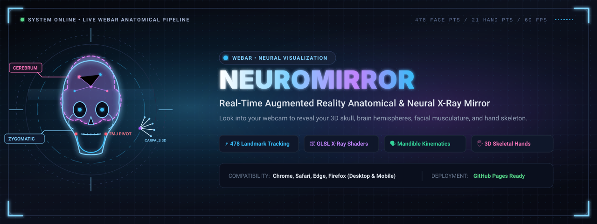
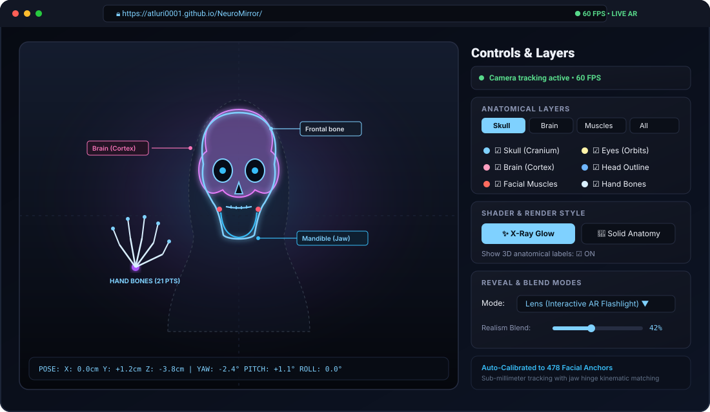
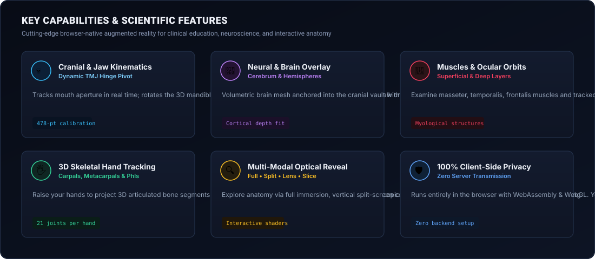
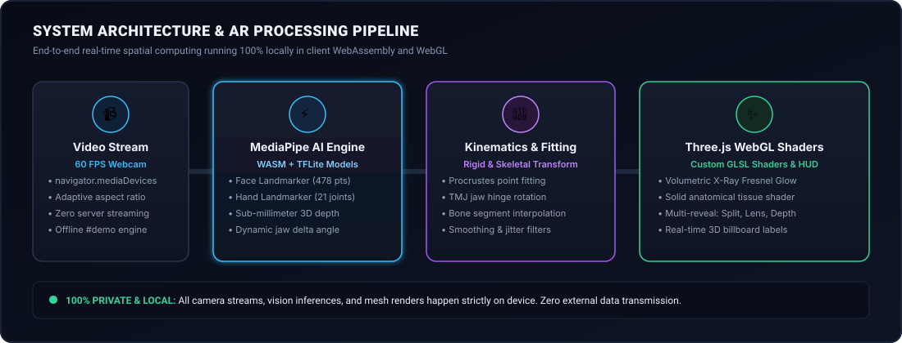

<div align="center">



# 🪞 NeuroMirror

### Real-Time Augmented Reality Anatomical & Neural X-Ray Mirror in Your Browser

[](https://atluri0001.github.io/NeuroMirror/)
[](https://atluri0001.github.io/NeuroMirror/#demo)
[](LICENSE)
[](https://developers.google.com/mediapipe)
[](https://threejs.org/)

<p align="center">
  <a href="https://atluri0001.github.io/NeuroMirror/"><b>🚀 Launch Live WebAR App</b></a> •
  <a href="https://atluri0001.github.io/NeuroMirror/#demo"><b>🧪 Try #demo Mode (No Camera Required)</b></a> •
  <a href="#-features"><b>✨ Explore Features</b></a> •
  <a href="#-architecture"><b>📐 Architecture</b></a>
</p>

</div>

---

## 🌟 Overview

**NeuroMirror** turns any standard web browser and webcam into an interactive, high-precision **augmented reality anatomical mirror**. Look directly into your camera, and NeuroMirror fits 3D anatomical structures—including your **skull**, **cerebral brain hemispheres**, **facial musculature**, **eyes**, and **articulated hand bones**—directly over your body in real time.

When you speak, smile, or open your mouth, the 3D mandible bone rotates around its anatomically accurate **temporomandibular (TMJ) jaw hinge**, maintaining seamless physical registration at 60 frames per second.

<div align="center">
  
</div>

---

## ✨ Features

<div align="center">
  
</div>

### 💀 1. Cranium & Dynamic Jaw Kinematics
- **478 Facial Landmarks**: Anchors 3D cranial models onto your head with sub-millimeter precision.
- **Dynamic TMJ Hinge**: Real-time jaw angle calculation. The 3D mandible tracks your oral aperture synchronously as you speak, yawn, or smile.

### 🧠 2. Neural Cortex & Brain Structure
- **Cerebral Hemispheres**: High-density 3D brain mesh situated inside the cranial vault.
- **Volumetric Lobes**: Visualizes frontal, parietal, occipital, and temporal structures in spatial depth.

### 💪 3. Facial Musculature & Eye Orbits
- **Superficial & Deep Muscles**: Renders masseter, temporalis, frontalis, and facial expression muscle groups.
- **Ocular Sockets**: Real-time optical orbits tracking head position and rotation.

### 🖐️ 4. 3D Articulated Skeletal Hands
- **21 Joints Per Hand**: Lift your hands to project 3D carpal, metacarpal, and phalangeal bone segments over your real fingers in stereoscopic depth.

### 🔍 5. Multi-Modal Optical Reveals
- **Whole Overlay**: Complete anatomical overlay over the live video stream.
- **Split-Screen View**: Vertical split comparison between your mirror reflection and internal anatomy.
- **AR Lens (Flashlight)**: Move an interactive circular lens across your face to reveal the structures underneath the skin.
- **Depth Slicing**: Cut across transverse anatomical planes to peel back superficial layers.

### 🏷️ 6. Real-Time 3D Anatomical Callouts
- **Dynamic Billboard Labels**: Turn on anatomical annotations (Frontal Bone, Parietal Bone, Mandible, Brain Cortex, etc.) that anchor to anatomical features and follow your movements live.

---

## 📐 Architecture & Processing Pipeline

NeuroMirror is designed to run **100% on the client side** with zero server-side computational dependencies. All computer vision inferences and WebGL shaders execute locally inside the browser.

<div align="center">
  
</div>

### Processing Stages:
1. **Video Ingestion**: WebRTC `getUserMedia` captures camera stream at 60 FPS.
2. **MediaPipe Tasks Vision**: WebAssembly and SIMD-accelerated models execute:
   - `face_landmarker.task` (478 3D points + facial blendshapes)
   - `hand_landmarker.task` (21 3D joint landmarks per hand)
3. **Kinematics Engine**: Fits the cranial base using Procrustes point alignment, calculates dynamic mandible rotation around the jaw pivot, and interpolates skeletal bone segments.
4. **Three.js WebGL Core & GLSL Shaders**:
   - Custom **Fresnel Holographic Glow** shader for futuristic blue/cyan X-ray styling.
   - **Solid Anatomical Tissue** shader with lighting and specular highlights.
   - Screen-space stencil masks for Split, Lens, and Depth slicing modes.
5. **HUD & Dynamic Callouts**: 2D canvas overlay renders billboarded anatomical pinpoints in sync with 3D projection matrices.

---

## 🚀 Quick Start

### 🌐 Option 1: Run Live on GitHub Pages (No Installation)

Simply navigate to the deployed GitHub Pages URL:

👉 **[https://atluri0001.github.io/NeuroMirror/](https://atluri0001.github.io/NeuroMirror/)**

> **Tip:** Don't have a camera or want a quick preview? Append `#demo` to launch the offline test environment with pre-recorded head and hand motion:
> 
> 👉 **[https://atluri0001.github.io/NeuroMirror/#demo](https://atluri0001.github.io/NeuroMirror/#demo)**

---

### 💻 Option 2: Run Locally

Because NeuroMirror accesses camera video streams via `navigator.mediaDevices`, it must be served over a secure origin (`http://localhost` or `https://`):

```bash
# 1. Clone the repository
git clone https://github.com/ATLURI0001/NeuroMirror.git
cd NeuroMirror

# 2. Start a local HTTP server
# Using Python 3:
python -m http.server 8000

# Or using Node.js:
npx serve .
```

Open your browser at `http://localhost:8000`.

---

## 🎛️ Controls & UI Guide

| Section | Control | Description |
| :--- | :--- | :--- |
| **Presets** | `Skull` / `Brain` / `Muscles` / `All` | Instant toggles for anatomical layer combinations. |
| **Layers** | `Skull`, `Brain`, `Muscles`, `Eyes`, `Outline`, `Hands` | Individual layer checkboxes for fine inspection. |
| **Labels** | `Show labels` | Activates real-time 3D billboarded anatomical pinpoints. |
| **Shader Look** | `X-ray` vs `Solid` | Toggle between luminous cyan holographic X-ray or natural anatomical tissue shaders. |
| **Reveal Mode** | `Whole` / `Half Split` / `Lens` / `Depth Cut` | Switch between full head, split screen, flashlight lens, or cross-sectional slice. |
| **Adjustments** | `Brightness`, `Realism Blend`, `Edge Feathering` | Fine-tune the optical transparency and blending. |
| **Calibration** | `Scale`, `Depth`, `Offset (X, Y, Z)` | Fine-tune anatomical fit to match individual cranial proportions. |

---

## 🛠️ Technology Stack

- **Computer Vision**: [Google MediaPipe Tasks Vision](https://developers.google.com/mediapipe/solutions/vision) (`@mediapipe/tasks-vision`)
- **3D Graphics Engine**: [Three.js r160](https://threejs.org/) (WebGL 2.0)
- **Shader Language**: Custom GLSL Vertex and Fragment Shaders
- **Binary Mesh Data**: Embedded high-density 3D anatomical meshes compressed into binary streams
- **Runtime**: Vanilla ES6 Modules & WebAssembly (Zero build step, zero dependencies, runs natively)
- **Deployment**: [GitHub Pages](https://pages.github.com/)

---

## 🔒 Privacy & Security

- **Strictly Local**: Your camera video feed is processed 100% in-memory on your local device.
- **Zero Network Transmission**: NeuroMirror does not record, store, or transmit your webcam stream or facial geometry to any external server.
- Review our [SECURITY.md](SECURITY.md) for full privacy and security details.

---

## 🤝 Contributing

Contributions to NeuroMirror are welcome! Whether you are adding new anatomical layers, optimizing GLSL shaders, or enhancing landmark calibration:

1. Check out [CONTRIBUTING.md](CONTRIBUTING.md) for development workflows and coding standards.
2. Read the [CODE_OF_CONDUCT.md](CODE_OF_CONDUCT.md) for our community guidelines.
3. Open an issue or submit a pull request!

---

## 📜 License

This project is licensed under the **MIT License** - see the [LICENSE](LICENSE) file for details.

---

<div align="center">
  <b>NeuroMirror</b> — Designed &amp; Maintained with ❤️ by <a href="https://github.com/ATLURI0001">Ram Prasad Atluri</a>
</div>
